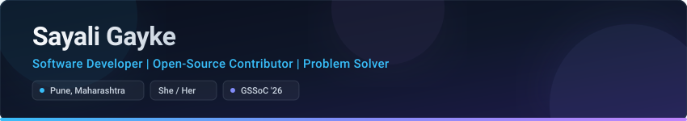

  <!-- Header Banner -->
  

    

  <!-- Headline & Subtitle -->
  <h1>Hi, I'm Sayali Gayke 👋</h1>
  
<strong>Software Developer &nbsp;|&nbsp; Open-Source Contributor &nbsp;|&nbsp; Problem Solver</strong>

  <!-- Quick Badges -->
  

    
    
    
    
    
  

  

    <em>Building practical, user-centric web applications and tackling algorithmic challenges with clean, maintainable code.</em>
  

---

## 👩‍💻 About Me

I am a motivated software developer based in Pune, India, dedicated to engineering reliable full-stack applications and solving complex computational problems. My approach combines strong computer science fundamentals with hands-on development across modern frontend and backend technologies.

- 🚀 **Full-Stack Development**: Crafting responsive, accessible web applications with React (18 & 19), TypeScript, Node.js, and Express.
- 🧠 **Problem Solving & DSA**: Actively strengthening algorithmic thinking, time-complexity analysis, and data structure implementations primarily in **Java**.
- 🗄️ **Database Architecture**: Designing relational and document-based data models with PostgreSQL, MongoDB, Prisma ORM, and MySQL.
- 🌐 **Open Source & Community**: Participating in **GirlScript Summer of Code 2026 (GSSoC'26)**, writing modular code, triaging issues, and collaborating via peer-reviewed pull requests.
- 📐 **Software Craftsmanship**: Committed to clean code architecture, defensive input validation (Zod, Joi), and secure authentication flows (JWT, HttpOnly cookies).

---

## 🌟 Featured Projects

These selected projects showcase my experience with end-to-end software development, architectural design, and practical problem solving.

<table width="100%">
  <tr>
    <!-- PROJECT 1: MentorHub -->
    <td width="50%" valign="top">
      

        <h3><a href="https://github.com/SAYALI8106/MentorHub">01. MentorHub</a></h3>
        
<strong>Full-Stack 1-on-1 Mentorship & Booking Platform</strong>

        

          A decoupled client-server web platform that connects students and professionals with verified industry mentors for career roadmaps, portfolio reviews, and mock interviews.
        

        <ul>
          <li><strong>Role-Based Access Control</strong>: Secure dual-role authentication (Mentors & Students) with bcryptjs and signed JWTs.</li>
          <li><strong>Live Discovery & Dynamic Search</strong>: Instant mentor filtering by expertise, job title, and skills.</li>
          <li><strong>Scheduling & Slot Engine</strong>: 14-day availability computation algorithm that filters conflicts and handles time windows.</li>
          <li><strong>Payments & Meetings</strong>: Seamless Razorpay payment gateway integration and automated video meeting link generation (Zoom API with secure Jitsi Meet fallback).</li>
        </ul>
        

          
          
          
          
          
          
        

        

          <a href="https://github.com/SAYALI8106/MentorHub"><strong>View Repository →</strong></a>
        

      

    </td>

    <!-- PROJECT 2: Culinaria -->
    <td width="50%" valign="top">
      

        <h3><a href="https://github.com/SAYALI8106/Culinaria">02. Culinaria</a></h3>
        
<strong>Enterprise Recipe Management & Culinary Discovery System</strong>

        

          A modern, type-safe culinary platform offering end-to-end recipe lifecycle management, multi-criteria recipe discovery, and community rating aggregation.
        

        <ul>
          <li><strong>Rich Recipe Authoring</strong>: Complete CRUD lifecycle with Tiptap rich-text editor, structured ingredients, difficulty levels, and dietary attributes.</li>
          <li><strong>Multi-Faceted Search Matrix</strong>: URL-synced discovery with filtering by cuisine, category, dietary needs, and prep-time sliders.</li>
          <li><strong>Community Ratings & Reviews</strong>: Interactive 5-star rating system with server-side aggregation and moderation controls.</li>
          <li><strong>Admin Telemetry & Bookmarks</strong>: Role-based admin dashboard with platform usage telemetry and one-click user bookmarking.</li>
        </ul>
        

          
          
          
          
          
          
        

        

          <a href="https://github.com/SAYALI8106/Culinaria"><strong>View Repository →</strong></a>
        

      

    </td>
  </tr>

  <tr>
    <!-- PROJECT 3: TaskSphere Pro -->
    <td width="50%" valign="top">
      

        <h3><a href="https://github.com/SAYALI8106/TaskSphere-Pro">03. TaskSphere Pro</a></h3>
        
<strong>Enterprise Task & Workflow Intelligence Platform</strong>

        

          A high-performance productivity platform engineered with strict multi-user tenant isolation, dual-engine data persistence, and real-time analytics.
        

        <ul>
          <li><strong>Dual-Engine Smart Database</strong>: Instant zero-config embedded persistence with seamless auto-switching to production Prisma + PostgreSQL.</li>
          <li><strong>Defense-in-Depth Auth</strong>: Bcrypt password hashing with JWTs transmitted exclusively via secure <code>HttpOnly</code> cookies to eliminate XSS risks.</li>
          <li><strong>Lifecycle Task Management</strong>: State tracking across TODO, IN_PROGRESS, and COMPLETED with priority flags, categories, and overdue deadline calculation.</li>
          <li><strong>Analytics Dashboard</strong>: Real-time metric cards for task completion tracking and debounced multi-attribute search and sorting.</li>
        </ul>
        

          
          
          
          
          
          
        

        

          <a href="https://github.com/SAYALI8106/TaskSphere-Pro"><strong>View Repository →</strong></a>
        

      

    </td>

    <!-- PROJECT 4: SmartCampus -->
    <td width="50%" valign="top">
      

        <h3><a href="https://github.com/SAYALI8106/SmartCampus">04. SmartCampus (DigiCampus)</a></h3>
        
<strong>Proxy-Free Dynamic QR Attendance Management System</strong>

        

          An institutional attendance solution that eliminates proxy attendance and manual paper rosters through a time-bounded cryptographic rotating QR code architecture.
        

        <ul>
          <li><strong>Rotating QR Architecture</strong>: Time-limited dynamic QR codes that refresh every 20 seconds to prevent absent peer screenshot sharing.</li>
          <li><strong>Roll-Number Token Binding</strong>: Cryptographic QR payload strictly bound to specific student roll numbers, branch, and session timestamps.</li>
          <li><strong>Camera & Web Scanner Portals</strong>: In-browser QR scanning with single-submission verification and device session locking.</li>
          <li><strong>Real-Time Cloud Backend</strong>: Instant attendance record synchronization using Firebase Firestore and live faculty lecture analytics.</li>
        </ul>
        

          
          
          
          
          
        

        

          <a href="https://github.com/SAYALI8106/SmartCampus"><strong>View Repository →</strong></a>
          &nbsp;&bull;&nbsp;
          <a href="https://digiicampus.netlify.app/"><strong>Live Demo 🚀</strong></a>
        

      

    </td>
  </tr>
</table>

---

## 🛠️ Technical Skills

Organized based on active application development, project codebases, and core coursework.

### Core Stack (Working With)

| Category | Technologies & Tools |
| :--- | :--- |
| **Programming Languages** |      |
| **Frontend Development** |        |
| **Backend & APIs** |      |
| **Databases & ORMs** |      |
| **Developer Tools** |         |
| **Computer Science Foundations** | Data Structures & Algorithms (DSA) &bull; Object-Oriented Programming (OOP) &bull; Database Management Systems (DBMS) &bull; CPU Scheduling & Operating Systems |

### Currently Exploring & Learning

- ☕ **Advanced Data Structures & Algorithms** using Java (Trees, Graphs, Dynamic Programming, Heap queues).
- 🏗️ **Full-Stack System Design**: Monorepo architectures, decoupled API microservices, and high-performance serverless endpoints.
- 🧪 **Automated Testing & CI/CD**: Integration testing with Supertest & Jest, along with GitHub Actions workflows.

---

## 🤝 Open Source & Community

Open-source development allows me to solve real-world problems collaboratively, follow established code review standards, and build software that benefits others.

- 🌟 **GirlScript Summer of Code 2026 (GSSoC'26)**: Active participant contributing to open-source software, triaging issues, and submitting code contributions.
- 🔄 **Collaborative Workflows**: Comfortable with feature branching, PR discussions, rebasing, issue tracking, and code refactoring within shared team repositories.
- 💡 **Community Engagement**: Passionate about knowledge sharing, clean documentation, and learning alongside other developers.

👉 **[View My GitHub Contribution Activity →](https://github.com/SAYALI8106?tab=repositories)**

---

## 📊 GitHub Activity & Statistics

  <table border="0">
    <tr>
      <td valign="middle" align="center">
        
      </td>
      <td valign="middle" align="center">
        
      </td>
    </tr>
    <tr>
      <td colspan="2" align="center">
        
      </td>
    </tr>
  </table>

---

## 🏆 Achievements & Badges

Recognitions earned through active development and community contribution:

- 🦈 **Pull Shark ×3** (Silver Tier) &mdash; Merged multiple collaborative pull requests.
- 👥 **Pair Extraordinaire ×2** (Bronze Tier) &mdash; Co-authored commits in team repositories.
- 🚀 **YOLO** &mdash; Merged code directly without a review pull request.
- ⚡ **Quickdraw** &mdash; Closed issues and pull requests within moments of opening.
- 🌸 **GSSoC'26 Contributor** &mdash; Participant in GirlScript Summer of Code 2026.

---

## 🎯 Current Focus

- 📘 Deepening **Data Structures & Algorithms** mastery in Java for optimal problem-solving speed and rigor.
- ⚛️ Exploring modern full-stack web architectures with **React 19**, **Next.js**, and type-safe backend systems.
- 🛡️ Building scalable, production-grade applications with robust authorization, database indexing, and automated testing.
- 🤝 Actively contributing to impactful open-source projects.

---

## 📫 Let's Connect!

I am always interested in discussing software engineering opportunities, open-source initiatives, and collaborative projects. Feel free to reach out through any of the channels below:

  
  &nbsp;&nbsp;
  
  &nbsp;&nbsp;
  

  📍 <strong>Location:</strong> Pune, Maharashtra, India &nbsp;&bull;&nbsp; ✉️ <strong>Direct Email:</strong> <a href="mailto:sayaligayke810@gmail.com">sayaligayke810@gmail.com</a>

  Designed &amp; crafted with care for <a href="https://github.com/SAYALI8106">@SAYALI8106</a>

